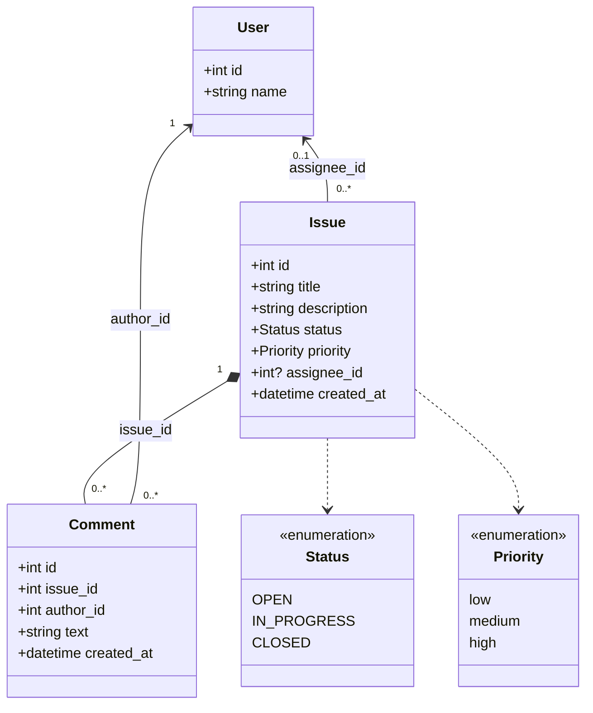
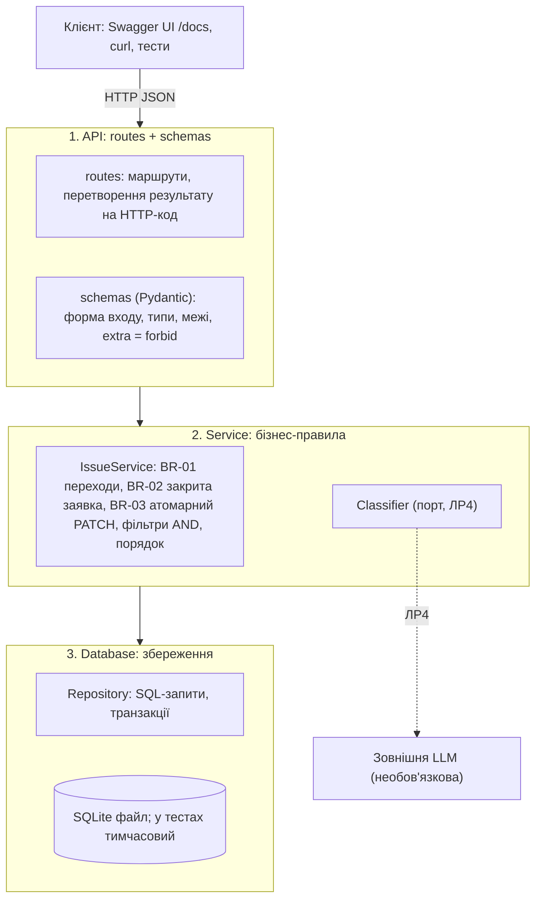

# Mini Issue Tracker — архітектура (ЛР1)

Бізнес-правила й поля визначено в [requirements.md](requirements.md) (BR-01–BR-04, розділ 6); тут лише розподіл
відповідальності між компонентами і рішення щодо архітектури.

## 1. Модель сутностей

Три сутності та два перелічувані типи (до 5 елементів моделі).

Таблиці SQLite: `users` (заповнюється двома записами під час ініціалізації бази), `issues`, `comments`.
Зовнішні ключі: `issues.assignee_id → users.id` (NULL дозволено), `comments.issue_id → issues.id`,
`comments.author_id → users.id`.

## 2. Компоненти та відповідальність

Три компоненти; кожен звертається лише до сусіднього нижнього шару.

| Компонент | Відповідає за | Не робить |
|-----------|---------------|-----------|
| **API** (`app/api/`, `app/schemas.py`) | Маршрути з [api-contract.md](api-contract.md); перевірка форми запиту (строгі типи, межі довжини після обрізання, enum, `extra=forbid`, невідомі параметри запиту, порожнє тіло PATCH, відомі id користувачів) → `422` до звернення до сервісу (D-01); перетворення помилок сервісу на `404`/`409`. | Не знає правил переходів і не звертається до бази напряму. |
| **Service** (`app/services/issue_service.py`) | Правила BR-01–BR-04: існування заявки (`NotFound`), матриця статусів і блокування `CLOSED` (`Conflict`), часткове оновлення лише переданих полів, порядок і фільтри. | Не формує HTTP-відповіді. |
| **Database** (`app/repository.py`, `app/db.py`) | Створення схеми та довідника користувачів, CRUD-запити, одна транзакція на операцію, шлях до файлу бази зі змінної `DATABASE_PATH` (NFR-03). | Не перевіряє бізнес-правила. |

**Що потрібно запрограмувати явно (не працює «з коробки» FastAPI).** `Path(gt=0)` для `{id}` (D-15); перевірка, що
в запиті немає невідомих query-параметрів (D-13); `model_config = ConfigDict(extra="forbid", strict=True)` і
`Literal[...]` для статусу, пріоритету та id користувачів (D-03, D-14); валідатор моделі PATCH проти порожнього тіла (D-02).
За замовчуванням FastAPI ігнорує зайві query-параметри, а `/issues/0` доходить до обробника — це враховано в плані ЛР2.

**Точка підключення AI (ЛР4).** У шарі Service оголошено інтерфейс `Classifier` з методом
`suggest(title, description) → Suggestion(category, priority, summary)`. У ЛР2 є лише реалізація-заглушка
`DisabledClassifier`, яка повідомляє, що рекомендації недоступні. Сервіс заявок від класифікатора не залежить, тому
FR-01–FR-07 працюють без LLM (NFR-05). Реальний виклик моделі не входить у ЛР1–ЛР3.

**Типовий потік (зміна статусу).** `PATCH /issues/1/status` → schemas перевіряє, що `status` є одним із трьох
значень (інакше `422`) → `IssueService.change_status` читає заявку (немає → `NotFound` → `404`), звіряє BR-01
(заборонено → `Conflict` → `409`; той самий статус → повернути без змін) → Repository оновлює статус у транзакції → `200`.

## 3. Рішення щодо архітектури

### ADR-01. SQLite і лише локальний запуск

- **Контекст.** Невелика команда, синтетичні дані, демонстрація через REST API і `/docs`. FR-07 вимагає збереження
  даних після перезапуску; NFR-01 вимагає запуску з чистого клону без ручного налаштування. Docker і хмара — поза обсягом.
- **Варіанти.** (1) SQLite-файл; (2) PostgreSQL у Docker; (3) зберігання в пам'яті або JSON-файлі.
- **Обране рішення.** SQLite через стандартний модуль `sqlite3`; шлях до файлу береться зі змінної `DATABASE_PATH` (звичайний шлях, типово `data/app.db`), база й
  довідник користувачів створюються під час першого запуску.
- **Причина.** Не потрібні сервер БД і Docker, є транзакції (атомарність, NFR-06) і зовнішні ключі; тестам достатньо
  тимчасового файлу (NFR-03). Варіант (3) не дає транзакцій і надійного збереження, варіант (2) порушує межі обсягу.
- **Наслідки й обмеження.** Один процес запису; не призначено для одночасної роботи багатьох користувачів і публічного
  розміщення. Для переходу на іншу СУБД змінюється лише шар Database.

### ADR-02. AI-компонент відокремлено від бізнес-логіки, він лише рекомендує

- **Контекст.** FR-08 (ЛР4): категорія, пріоритет і короткий підсумок; рекомендація не повинна змінювати заявку
  автоматично. LLM може бути недоступною, повільною або помилятися; ключі не можна зберігати в репозиторії (NFR-04).
- **Варіанти.** (1) Сервіс заявок сам викликає LLM під час створення і записує результат у заявку; (2) окремий порт
  `Classifier`, результат повертається клієнту як пропозиція, а застосувати її може лише людина звичайним `PATCH`.
- **Обране рішення.** Варіант 2.
- **Причина.** Відповідає FR-08 (людина вирішує), основні функції не залежать від доступності LLM (NFR-05),
  класифікатор можна підмінити заглушкою в тестах.
- **Наслідки й обмеження.** Користувач робить два кроки: отримати рекомендацію і застосувати її. Маршрут рекомендації
  та формат відповіді проєктуються в ЛР4 (відкрите питання Q-01 про перелік категорій).
